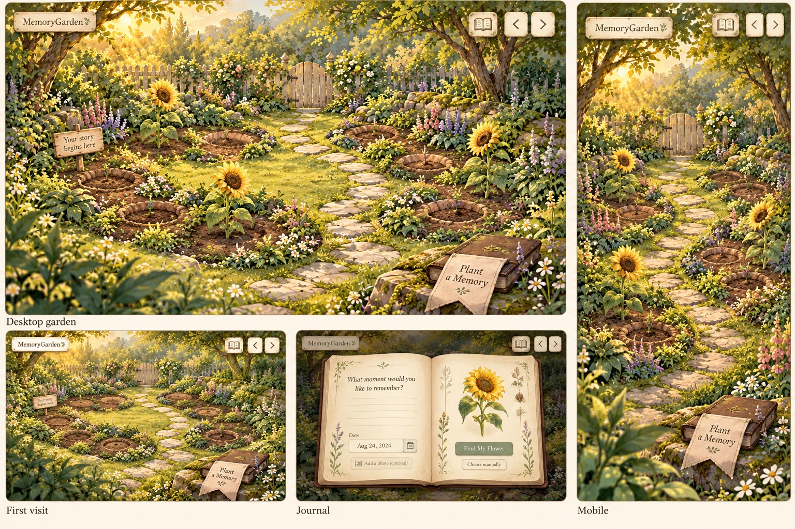
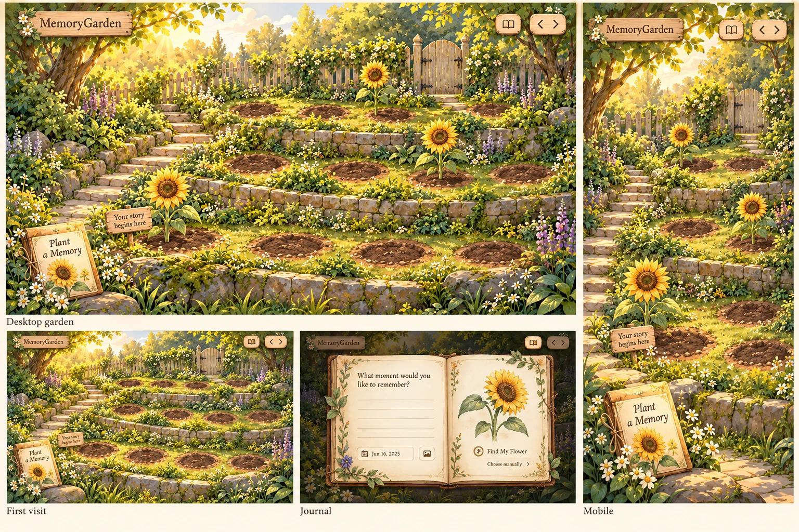
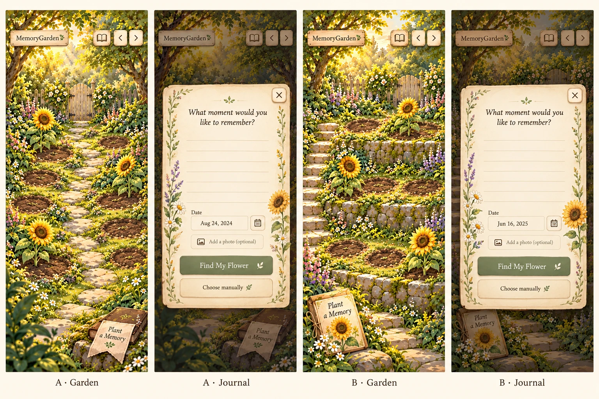

# MemoryGarden — choose the garden composition

**Decision pending. Application implementation is stopped.** Both Slice 1 pilots were visually rejected. Existing application code, illustrations and useful growth behavior are preserved. This proposal changes no approved scope, architecture, privacy requirement or workflow. It is a design discussion before further application work.

Open [the visual review page](design-proposal.html) for both boards and the mobile journal study. These are generated concept mockups, not screenshots of a working redesigned application or approved production assets.

## What the earlier pilots missed

The product needs a composed place with recognizable planting areas, depth and a clear relationship between the garden and the journal. Removing overflow and moving controls did not establish that experience. A single flat painting, independent flower and separate action strip left the scene feeling like a website.

The approved `scope.md > The Unique Kernel` and `prd.md > Screens and Layout`, `Look and Feel`, `Planting Spots and Garden Pages`, and `Plant and Bloom` remain the basis: a slightly elevated, hand-painted 2D world; fixed natural planting spots; small integrated controls; a botanical book; and a complete memory journey. No character movement, new environment-selection feature, game engine or gardening maintenance is proposed.

## A — The Secret Glade (recommended)

**Spatial idea:** an enclosed clearing with two curved planting beds and a small stepping-stone loop. Trees and hedges form the background, the beds hold the interactive midground, and a few foreground leaves frame the view. The garden fills the viewport behind small floating controls.

- **Identity:** a small cream botanical tag at the upper left, with no header strip.
- **Planting locations:** ten stable soil anchors grouped naturally across the two beds. Empty anchors read as shallow disturbed earth. The first gets the small “Your story begins here” sign; the rest stay visually quiet.
- **Existing flowers:** planted within those beds, sized for their depth, with a restrained soil-contact shadow and a few grass blades crossing the lowest stem. Foreground greenery never covers the bloom or its accessible target.
- **Primary action:** an illustrated closed journal on a small foreground rock, with an always-readable “Plant a Memory” cloth bookmark. The bookmark and book form one real HTML button with a generous hit area. They remain within the viewport's safe area.
- **Other controls:** small journal and garden-page controls at the upper right. Their cream/wood treatment matches the scene; there is no toolbar or full-width footer. Development tools stay outside the product layout.
- **Mobile:** recompose the beds vertically around a narrower path, retaining the same ten logical spots and comfortable targets. Use a portrait companion composition rather than cropping away roots or shrinking desktop controls.
- **Journal:** the foreground book opens into the approved two-page botanical journal over a softly dimmed garden. Mobile uses one comfortable page. Closing returns to the same scene/page/flower.

**Feasibility:** closest to the existing garden's mood and the simplest camera/ground model. Reuse the sunflower, palette, botanical references, growth logic and relevant checks. Expect a recomposed landscape painting, a matching portrait composition and sparse foreground/ground-contact artwork. The current flat painting can guide or contribute to that artwork; it cannot be assumed to contain clean, separately editable layers.

**Art refinement to agree:** the concept board makes some empty plots too deep and outlined. The intended final treatment is shallow soil within a continuous bed, with soft irregular edges and fewer competing decorative flowers. The central experience is the user's flowers.

## B — The Terraced Story Garden

**Spatial idea:** three gently curved planting terraces separated by low stone edges. A short diagonal stair/path joins foreground, middle and background. The depth is more architectural and the planting areas are immediately legible.

- **Identity:** a small wooden garden tag upper left, visually attached to the world; no header band.
- **Planting locations:** ten stable roots across the three terraces: four front, three middle, three back. The arrangement has organic spacing rather than a visible grid. These are the same kinds of fixed spots and repeated garden pages already approved.
- **Existing flowers:** grounded on terrace surfaces, with smaller back flowers and larger front flowers. Stone/grass edges provide limited stem occlusion and stronger depth cues. Flowers remain individually selectable.
- **Primary action:** a seed packet with a botanical journal motif beside the foreground path entrance, carrying the clear “Plant a Memory” label. It opens the same journal workflow as A.
- **Other controls:** small floating book/page controls at the upper right. No management panels or persistent labels across the beds.
- **Mobile:** stack the same three terraces vertically and reposition the same logical spot IDs. All roots remain in view; decorative stair edges cannot consume the touch space.
- **Journal:** a botanical book opens from the seed-packet/book invitation, with the terraces visible behind it. Desktop has two pages; mobile has one. There is no separate product flower-information card.

**Feasibility:** the React/Vite/CSS architecture still fits. It needs a newly composed landscape and portrait scene plus aligned front/middle stone-edge masks or overlays. Depth sorting and mobile spacing require more art/layout coordination than A. No 3D geometry, physics or movement system is needed.

**Tradeoff:** stronger depth and clearer planting structure, with a more formal arrangement. Stone layers add asset work and can conceal stems or targets if poorly aligned. Keep the terraces gentle and irregular to retain a personal, peaceful garden feeling.

## Mobile and journal study

Both directions use the same journal identity: warm paper, thin botanical margins, readable real HTML text/inputs, subtle date/photo controls, optional AI suggestions and an equally clear manual choice. The generated dates, line counts, icons and exact letterforms are illustrative, not new requirements. No AI request happens on opening or typing; the approved consent and review rules remain unchanged.

The concept art suggests proportions and atmosphere. It does not prove ten correctly spaced controls, contrast, keyboard behavior or a working animation. In particular, the generative boards vary the exact number/shape of soil marks. Ten stable spots, 44 CSS px targets, readable controls and the four requested viewport sizes remain explicit constraints for the chosen direction's layout proof.

## The interaction that makes either scene a product

1. **Arrive:** see an inviting empty garden with clear natural beds and the book/seed-packet invitation. Hover/focus feedback is restrained; decorative foliage does not compete with the memory flowers.
2. **Write:** “Plant a Memory” opens the real journal. Write/date/photo, manual or consented AI suggestions, and editable review follow the approved journey.
3. **Choose a spot:** close the book into the existing garden-selection step. Empty soil locations gain a soft leaf/soil highlight; one available position is selected automatically. Another empty position can be chosen. Occupied roots are protected.
4. **Plant:** after successful local persistence, attention rests on that location. The seed settles, a distinct sprout emerges, the plant grows, and the selected flower blooms from the same root. Root grass and the ground shadow tie all stages to the bed. Motion quality needs a fresh live pilot; static concept art cannot establish it.
5. **Revisit:** selecting a planted flower opens its actual reading journal. A small hover/focus title may help discovery, but a large botanical info card is not a separate product screen. Close/Escape restores the same place.

Ambient motion comes from a few separate foliage/particle elements and slow flower sway. All essential actions remain available with reduced motion, where planting shows the final state immediately. Development-only stage inspection/replay must not define the user-facing composition.

## Asset and implementation comparison

| Decision | A — Secret Glade | B — Terraced Story Garden |
| --- | --- | --- |
| Feeling | Intimate, organic, softly enclosed | Miniature landscape with stronger stepped depth |
| Camera/placement | One continuous ground plane with grouped beds | Three painted depth bands with stable root anchors |
| Existing work retained | Sunflower, art direction/reference, growth behavior and useful tests | Same reusable work |
| New/reworked environment art | Landscape base, portrait counterpart, sparse foreground/ground-contact details | Landscape/portrait bases, additional aligned stone/grass occlusion layers |
| Mobile effort | Re-block two curves and the same ten spots | Re-block all three shelves, stairs, occlusion and ten spots |
| Implementation | Layered images plus HTML buttons/SVG/CSS; existing stack | Same stack, with more depth/layer coordination |
| Main risk | Empty beds need to stay gentle and inviting rather than crater-like | Formal rows and stone edges could dominate the flowers |

For either choice, the final background must exclude planted memory flowers and functional lettering. Memory flowers, text/buttons, journal fields and accessible targets remain independent elements. These flattened concept boards will **not** become production backgrounds. No full flower collection is being generated during this decision.

## Recommendation and approval

**Recommend A — The Secret Glade**, with shallow continuous beds and calmer edge detail. It best supports the intimate sanctuary feeling while keeping art layering and mobile placement manageable. It also gives the journal a physical place in the world and makes planting locations intentional.

Choose B if the terraced depth and structured planting areas are closer to the miniature-world feeling you want; the additional art coordination is feasible within the chosen architecture.

The decision here is the environment composition, planting-area treatment, control metaphor and journal relationship—not approval of every generated pixel or declaration that Slice 1 is complete. Once a direction is approved, prove that composition with the existing sunflower at desktop/mobile sizes before producing the other flowers. The actual revised pilot still needs separate visual acceptance before Slice 2.

**Which direction feels closest to your MemoryGarden, and what would you change before we implement it?**

## Artifact provenance

Built-in `image_gen` produced these design-only boards on 2026-10-20, using the existing garden/sunflower as style references. Original PNGs and WebP review exports are in `devpost/design-exploration/`. WebP conversion uses Sharp quality 90, preserving composition; source PNGs remain unchanged.

| Board | Original output ID |
| --- | --- |
| `a-secret-glade-v1.png` | `exec-98f7e91f-2ffe-4f0a-8194-75f9c79bfcaf` |
| `b-terraced-garden-v1.png` | `exec-73be9145-f066-4ce1-84e1-20731125fce3` |
| `mobile-journals-v1.png` | `exec-f94caf06-4048-4df9-9c65-5cbec5e2b279` |

Generation session: `01a15043-e43b-73c0-a08a-73f791401ccd`. Full concept prompts/reference roles: [prompts.json](design-exploration/prompts.json) and [mobile-prompt.txt](design-exploration/mobile-prompt.txt). The tool does not expose a model version here; none is inferred. Publication/redistribution rights remain a later verification gate, not an asserted license.
