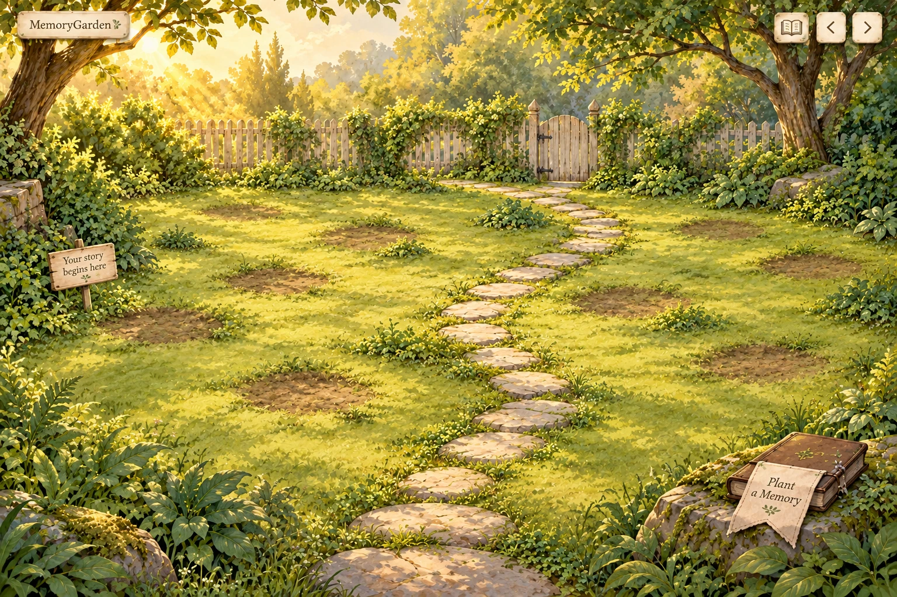
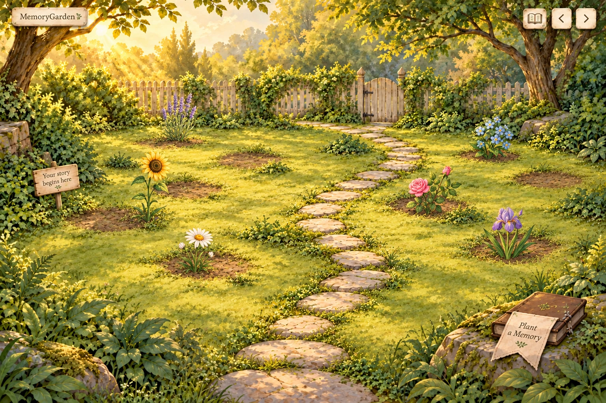
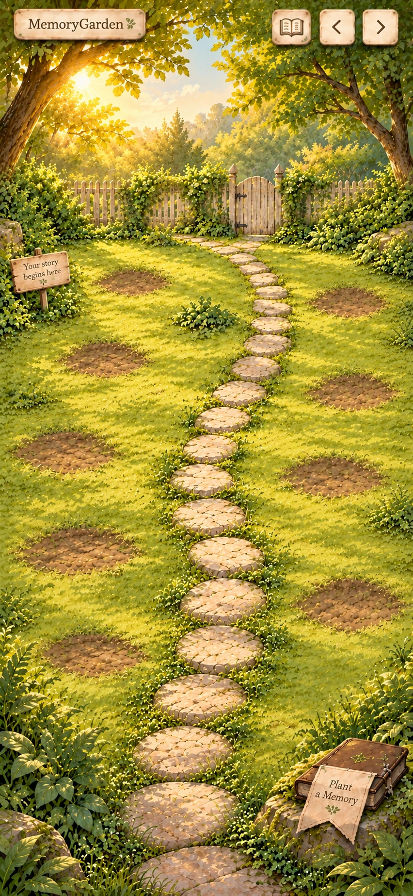
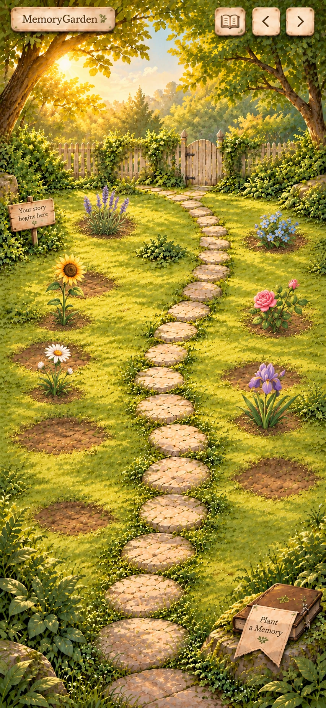

# MemoryGarden — Secret Glade A2

**Revised design previews, awaiting approval. Slice 1 and application implementation remain paused.** Direction A is the learner's preference, not final design approval. Existing application code and production assets are unchanged by this revision.

Open [the visual review page](design-proposal.html). The four images below are concept illustrations, not screenshots of a newly implemented application.

## Which board is which?

The latest attachment shows six botanical reference cards; it contains no garden scene. In the earlier proposal, **B — Terraced Story Garden** has three stepped stone planting levels. **A — Secret Glade** has continuous level ground, although its first board also had overly prominent stone rims around soil holes. A2 removes both the terracing and the conspicuous circular treatment.

The original A/B comparison and journal study remain available in [the archived first proposal](design-proposal-round-1.html). B is not an additional MVP environment. The current review is exclusively Secret Glade A2.

## Desktop — empty and partially planted

### Empty garden

One level clearing, with trees, wooden fence, flush stepping stones, warm sunlight and foliage around the edges. The central planting areas are quieter. Soil marks are shallow, irregular and feathered into the grass. The empty background contains no memory flowers.

### Six memory-flower types added

Sunflower, lavender, rose, daisy, forget-me-not and iris are shown as user-planted memories. Their different silhouettes and colors share the garden's painterly rendering and upper-left light. Each has its own ground contact; open patches remain between them. These six concept paintings are not separately generated production sprites or a completed asset collection.

## Mobile — intentionally recomposed

### Empty garden

### Partially planted garden

The portrait composition raises the fence line to leave more space for the ground and planting areas. It keeps the same glade identity, with a narrower path, edge foliage and a visible book invitation. It is not a squeezed landscape screenshot. The planted view shows the same six flower types in that portrait setting.

## What changed

| Requested refinement | A2 treatment |
| --- | --- |
| Less crowded planting areas | Broad, calm grass areas; decorative detail concentrates at the perimeter |
| Preserve illustrated environment | Trees, fence, path, warm light and edge greenery remain |
| Keep memory flowers distinct | Empty scenery has no large floral specimens; six recognizable memory types are added only in the planted studies |
| Replace holes and rings | Flat irregular soil scuffs, without stone rims or raised terraces |
| Cohesive flower family | Shared warm gouache/watercolor texture, lighting, rooted whole-plant silhouettes and depth-aware scale |
| Beautiful empty and growing states | Light/foliage make the empty scene welcoming; memory flowers add the prominent color and botanical variety |

The small identity tag and floating book/page controls remain inside the world. The primary “Plant a Memory” invitation is a foreground botanical book with a cloth bookmark. Page arrows represent more pages of the **same garden**, not a choice of environments. The approved desktop two-page/mobile single-page journal behavior remains unchanged; the earlier journal study is archived rather than regenerated in this round.

## One garden now; stable positions for future atmosphere

The MVP contains **one Secret Glade**, reused across garden pages. Morning, golden-hour and evening variations remain future-only; none is implemented or supplied as a new environment here.

The architecture already separates illustrated scenery from logical spot IDs. Preserve that boundary: memory placement belongs to `pageId` + `spotId` in the chosen scene layout, independently of any future lighting/art choice. A future atmosphere must use registered scenery with the same geometry/anchors, or lighting overlays, without reallocating memories. Desktop and mobile may have their agreed corresponding spot maps; changing atmosphere must not change either map. This is a planning constraint, not new theme infrastructure or UI.

## What this preview does and does not establish

The images establish the proposed visual density, botanical family, flat-ground composition and empty-to-planted contrast. Generated edits are not pixel-registered placement proofs: some soil edges/root locations drift between the empty and planted studies. Exact ten-spot geometry, accessible hit areas, responsive safe areas and animation quality still require the chosen direction's real layout proof after approval. The native images are 1536×1024 desktop and 852×1846 portrait, not evidence of a functioning application at the four target viewport sizes.

For implementation, background art must exclude memory flowers and functional lettering. Flowers, rooted positions, book/control hit areas, text, journal fields and foreground occlusion remain independent elements. These flattened previews will not be substituted for the application's interactive scene. The supplied flower sheet informed botanical shapes; its cards/art were not adopted as a licensed sprite library.

**Please review A2's planting-area quietness, flower cohesion, empty-to-planted improvement and mobile composition before approving the final direction.** Application code, production asset generation and Slice 2 remain on hold.

## Files and provenance

Built-in **image_gen** generated these concept previews on 2026-10-20. Original PNGs, WebP review exports and exact prompts are in `devpost/design-exploration/secret-glade-v2/`. WebP exports use Sharp quality 90 without semantic artwork changes.

| Selected image | Generation output ID | Reference role |
| --- | --- | --- |
| `desktop-empty.png` | `exec-0592d0df-6578-4e9e-acc1-4d886681af14` | Existing garden style and A1's interaction metaphor, with quieter level ground |
| `desktop-planted.png` | `exec-181b51fc-6913-4749-bfc3-4a8da633e92a` | Empty desktop as edit target; supplied flower sheet as species reference |
| `mobile-empty.png` | `exec-3d9580a1-206a-4978-ad36-88e49ea16ea8` | Recomposition of first portrait candidate, itself based on empty desktop |
| `mobile-planted.png` | `exec-1bd98b94-327e-49cf-9787-4afd43c9e600` | Empty portrait as edit target; planted desktop for style; flower sheet for species |

First portrait candidate: `exec-2a1eb43d-721b-46db-a9f7-d2fbbd638a69`; its canopy took too much space and was recomposed. One earlier portrait request failed with a connection error and was retried through the same built-in tool. Generation session: `01a15043-e43b-73c0-a08a-73f791401ccd`. No model version was exposed by the tool. Reference provenance and later publication-rights checks remain recorded; no redistribution license is asserted here.

Exact prompt set: [desktop empty](design-exploration/secret-glade-v2/desktop-empty-prompt.txt), [desktop planted](design-exploration/secret-glade-v2/desktop-planted-prompt.txt), [mobile base](design-exploration/secret-glade-v2/mobile-empty-prompt.txt), [mobile recomposition](design-exploration/secret-glade-v2/mobile-recompose-prompt.txt), [mobile planted](design-exploration/secret-glade-v2/mobile-planted-prompt.txt). Export dimensions/bytes: [export-metrics.json](design-exploration/secret-glade-v2/export-metrics.json).
